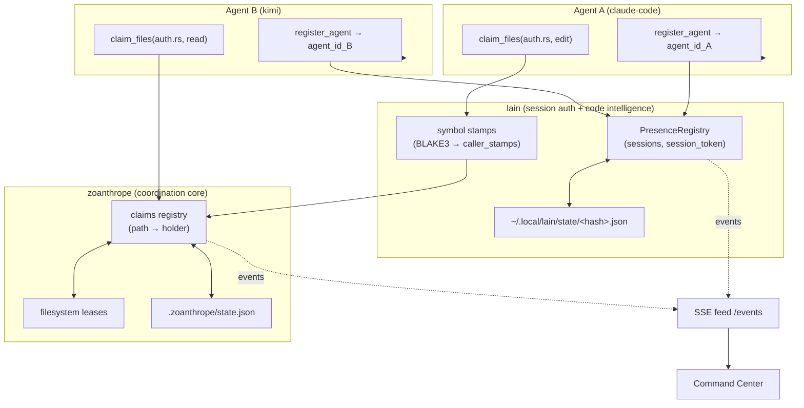
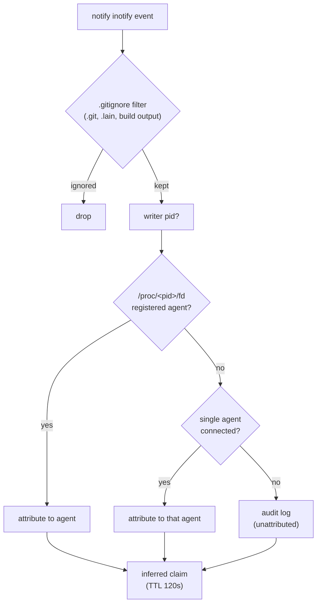

# Multiplayer Awareness

> lain 0.5+ ships an always-on multiplayer layer so multiple agents (Claude,
> Kimi, Cursor, OpenCode, humans) can edit the same workspace without
> stomping on each other. This page is the operator + agent quickstart.



Two agents register, both want the same file. **Coordination is
zoanthrope's** (`src/server/coordination/` is lain's proxy to it):
the per-path claim registry, the exclusive filesystem leases, and
the cross-process state (`<workspace>/.zoanthrope/state.json`) all
live in the zoanthrope binary. Lain keeps the session auth table
(`session_token`, heartbeat), the code-intelligence half (symbol
fingerprints pinned as opaque `caller_stamps` on each claim), and the
SSE feed the Command Center consumes. Every mutation pushes an event
into that feed.

Tool names did not change — `claim_files`, `release_files`,
`lain_intent` and friends answer the same JSON shapes they always
have (adapters over `zoanthrope claim|release|rejoin` and its
postboard). What changed is the arbitration underneath: see
[Arbitration](#arbitration-zoanthrope-contract) below.

## Operator quickstart

Multiplayer is always on. Start `lain server` like you already do — the
extra surface is 21 MCP tools (the Session, Social, and Notes packages)
plus the `POST /hook` observation endpoint and the SSE feed that the
existing Command Center picks up automatically:

```bash
# Start lain with the multiplayer features enabled (always-on in v0.5+)
lain server --config ./repos.yaml --transport http --port 9999
```

What's new on the wire:

| Surface | Purpose |
|---|---|
| 21 MCP tools (the multiplayer surface) | Presence: `register_agent`, `heartbeat`, `unregister_agent`, `list_active_agents`, `who_am_i`, `list_subagents`, `my_claims`. Coordination: `claim_files`, `release_files`, `list_occupancy`. Intent: `lain_intent`, `list_active_intents`. Diagnostics: `detect_overlap`, `get_audit_log`, `get_world_state`, `get_recent_activity`. (The remaining 5 rows each document one tool or tool group.) |
| `register_agent`, `heartbeat`, `list_active_agents`, `who_am_i`, `claim_files`, `release_files`, `list_occupancy`, `my_claims` | The eight core call-shape tools introduced with the layer. |
| `unregister_agent` | Tear down an agent's session: releases every claim, drops the intent + activity feed entries, removes the presence session. See [Lifecycle](#lifecycle). |
| `lain_intent`, `list_active_intents` | The intent layer: declare a goal + scope, get a coordination level back (GREEN / YELLOW / RED). See [Intent layer](#intent-layer). |
| `list_subagents` | Enumerate child sessions of a parent (passes parent session token). See [Subagents](#subagents). |
| `detect_overlap` | Symbol-level conflict scan between two git refs. See [Commit-time overlap detection](#commit-time-overlap-detection). |
| `get_audit_log` | Read recent claim and edit events. |
| `get_world_state` | On-demand snapshot of the world-state envelope (changed symbols since a given `plan_revision`). See [world_state.changed_symbols](#world_statechanged_symbols). |
| `get_recent_activity` | Recent activity feed (server-agnostic, polled). |
| `POST /hook` | Tool-call observation ingestion from the agent's host-specific hook layer (Claude Code PostToolUse, AGY / Kimi / Codex pre-tool, …). Populates the activity feed surfaced via `list_active_intents` / `who_am_i`. See [docs/hooks.md](hooks.md#activity-observation). |
| `POST /hook/evaluate` | Synchronous pre-edit consult: POST a target path or symbol, get back `Level + reason + related[]`. Wraps the `lain_intent` GREEN/YELLOW/RED evaluator for agents that want a YES/NO answer before Edit fires. See [docs/hooks.md](hooks.md). |
| `GET /events` | Server-Sent Events stream. Fires whenever an agent joins, claims, releases, or a conflict is detected. The Command Center subscribes here for its live panels. |
| Command Center panels | `GET /` now shows the **Agents online** and **Rooms** (file occupancy) panels, updated live. |
| Existing tools | `query_graph`, `get_repo_info`, `explain_symbol`, and `get_cross_repo_blast_radius` now include attribution hints (active editors) and surfaces occupancy where it's relevant. |

Coordination needs the **zoanthrope** binary on `PATH` (or
`$ZOANTHROPE_BIN`): `npm install -g @spuentesp/zoanthrope` is the
documented install. Without it lain still runs — coordination
degrades to advisory semantics (see [Arbitration](#arbitration-zoanthrope-contract)).

## Agent quickstart

Every agent that wants to participate goes through this 4-call dance:

```js
const { agent_id, session_token, expires_at_unix } = await mcp.call("register_agent", {name: "claude", kind: "claude-code", pid: process.pid});

// Before editing auth.rs, claim it.
const { granted, conflicts, advisories, degraded } = await mcp.call("claim_files", {agent_id, session_token, files: [{path: "auth.rs", symbols: ["login"], intent: "edit"}]});
if (conflicts.length > 0) {
  // Refused: another agent holds the file. Pick another scope.
  for (const c of conflicts) console.warn(`agent ${c.agent_id} holds this file`);
}
for (const a of advisories ?? []) {
  // Granted, but arbitration could not be consulted — re-read before patching.
  console.warn(a.note);
}
if (degraded) console.warn(`coordination degraded: ${degraded}`);

// After editing:
await mcp.call("release_files", {agent_id, session_token, files: [{path: "auth.rs"}]});
```

No heartbeat loop: **any authenticated call counts as proof of life**.
An explicit `heartbeat` exists for an agent that goes quiet for a long
time, but an agent doing ordinary work never needs to schedule one.

The four calls in plain English:

1. **`register_agent`** — once at startup. lain assigns an
   `agent_id` (UUID) and a `session_token` (opaque hex string). The
   token is the agent's bearer credential for every subsequent call;
   keep it secret.
2. **`heartbeat`** — optional. Any authenticated call already refreshes
   the session, so this is only for an agent that will be idle a long
   time. Interactive sessions expire after 10 minutes without a call,
   background (cron/CI) ones after 60 seconds; both are configurable
   under `presence` in the tuning config.
3. **`claim_files`** — before editing. Pass an array of
   `{path, symbols?, intent?}` entries. `intent` is `edit` or `read`;
   `symbols` is an optional list of symbol names — lain fingerprints
   each declared symbol body (BLAKE3) and pins the hashes on the claim
   as zoanthrope `caller_stamps` (`symbol:<name>`), so a later check
   can detect drift. The pins are *evidence*, not scope: arbitration
   is file-granular (see [Arbitration](#arbitration-zoanthrope-contract)).
   lain returns `{granted, conflicts, advisories, degraded?}`:
   - `conflicts` — your claim was **refused**; another agent holds the
     file (any intent — a `read` claim conflicts with an editor's hold
     too). Each entry names the holder (`agent_id`, `name`, and the
     `holder` spelling zoanthrope uses), their intent, when they were
     last seen, and whether the claim was `inferred`
     (guessed by the attribution watcher) rather than declared.
   - `advisories` — your claim was **granted**, but arbitration could
     not be consulted (zoanthrope transport error). Re-read before you
     patch. (Pre-refactor this is where a read over a live edit
     appeared; that case is a conflict now.)
   - `degraded` — `"zoanthrope-missing"`: no zoanthrope installed, so
     the claim was advisory (logged, never enforced).

   Conflicts carry the holder's `name` alongside its
   `agent_id`, so you do not need a second call to learn who. `name` is
   `null` when that session has since ended — never a fabricated
   placeholder.

   Paths are canonicalized, so `/abs/auth.rs`, `auth.rs` and
   `./auth.rs` are the same claim.
4. **`release_files`** — after editing. Frees the claim so the next
   agent can pick it up.

You can also poll without claiming — `list_occupancy` (optionally
scoped with `path`) reports who currently holds claims on a file, and
`list_active_agents` enumerates every connected session.

Each occupancy entry carries `holders`:

```json
{ "path": "/repo/src/auth.rs",
  "holders": [ { "agent_id": "…", "name": "alice", "intent": "edit", "inferred": false },
               { "agent_id": "…", "name": "bob",   "intent": "read", "inferred": false } ] }
```

Read `intent` before concluding anything: claims are file-granular —
an `edit` claim makes anything another agent holds on that file
conflict (including reads), and a `read` claim conflicts with an
editor's hold. Readers co-hold with each other. Without the intent a
surveying agent cannot tell a blocking hold from a harmless one —
two agents on a live server drew exactly the wrong conclusion from a
bare list of ids.

### Listening for events (push)

Connect to the SSE stream and lain will keep you in the loop — no
polling required:

```bash
curl -N http://localhost:9999/events
# event: ready
# data: {}
#
# event: agent_joined
# data: {"agent_id":"5f74f...", "name":"claude", "kind":"claude-code"}
#
# event: claim_granted
# data: {"agent_id":"5f74f...", "path":"auth.rs"}
```

Event types: `ready` (initial sync), `agent_joined`, `agent_left`,
`heartbeat_expired`, `claim_granted`, `claim_released`, `claim_revoked`,
`conflict_detected`, `edit_landed`. The Command Center consumes this
stream verbatim.

`claim_released` and `claim_revoked` are deliberately distinct.
*Released* means the holder gave the claim up. *Revoked* means it was
taken away — its session expired or was unregistered — and carries a
`reason` (`session_expired`, `unregistered`). The holder may still
believe it owns the file, so a subscriber seeing a revocation should
treat that agent's in-flight edit as unprotected. Claims themselves
never expire on a timer: per-claim `ttl_seconds` is accepted but not
enforced (see [Arbitration](#arbitration-zoanthrope-contract)).

## Arbitration (zoanthrope contract)

Claim arbitration is zoanthrope's; lain's `claim_files` /
`release_files` are adapters. The contract the swarm experiments
validated:

- **File-granular.** A claim covers the whole path. `symbols` ride
  along as `caller_stamps` (`symbol:<name>` = BLAKE3 of the symbol
  body) so lain can later detect drift — pins are evidence, never
  scope.
- **Strict.** An edit claim conflicts with anything another agent
  holds on the path; a read claim conflicts with an edit; readers
  co-hold with each other. A refused batch is all-or-nothing per
  call, and every refusal names the holder.
- **Never auto-released.** Release (or session teardown) hands a file
  over. A holder silent past the presence TTL is `stale` and still
  blocks. `zoanthrope rejoin` re-asserts a returning agent's claims
  without breaking anyone else's.
- **Content-bound.** Every claim records a content fingerprint of the
  file; a guarded write against a changed file is refused as
  `stale-claim` (re-read, re-claim). Caller stamps are not checked by
  zoanthrope — verifying them is lain's business.

Modes and degraded behavior are runtime knobs, not wiring:

| Knob | Effect |
|---|---|
| `ZOANTHROPE_MODE=advisory\|blocking` (or `{"mode": …}` in `.zoanthrope/config.json`) | Whether the *hook layer* denies a tool call on conflict (blocking) or only reports it (advisory). Claim arbitration is identical either way. |
| `ZOANTHROPE_BIN` | Where to find the `zoanthrope` binary (default: `PATH`). |
| (no binary found) | **Degraded**: claims are advisory — logged, never blocked — and responses carry `"degraded": "zoanthrope-missing"`. Lain stays installable standalone. |

The formal specs (PresenceClaims, FsLease/FsLeaseGuard,
RejoinProtocol) live in zoanthrope's `formal/`; lain's
[`docs/formal/COORDINATION.md`](formal/COORDINATION.md) points there
and records what stayed in lain. The hook family
(`hooks/<agent>/pre-edit.sh`) runs `zoanthrope claim` directly — see
[`hooks/README.md`](../hooks/README.md).

## How attribution works (defensive layer)

If an agent forgets to call `claim_files`, lain still knows:



1. **Inotify** watches the workspace. Events are filtered first: the
   repo's own `.gitignore` decides what is build output, plus `.git/`
   and `.lain/` (which git cannot report as ignored) and editor scratch
   files. Without that filter every write under the checkout became a
   claim — an agent that never ran git was once found holding
   `.git/index.lock` for its entire session.
2. **`/proc/<pid>/fd`** looks for the writer's PID. If a registered agent has that PID, lain auto-claims on their behalf.
3. **Single-agent fallback**: if only one agent is connected, edits are attributed to them. This carries most attributions, because a write usually closes its file descriptor before the inotify event is handled.
4. **Audit log**: unattributed edits are logged to stderr so the operator can investigate.

Claims created this way are marked **`inferred: true`**. They are a
guess: they say so on every surface that reports them. They do not
self-expire (claims are never auto-released) — they end when the
session ends or the claim is released — and a claim the agent later
declares itself is upgraded to a declared claim; an inference never
downgrades a declaration.

## Lifecycle

The session lifecycle has three MCP tools:

1. **`register_agent`** — create a session and receive `agent_id` +
   `session_token`. Every subsequent multiplayer call carries both.
2. **`heartbeat`** — refresh `last_heartbeat`. The expiry loop
   drops the session (and releases every claim, intent, and
   activity entry) after the interactive TTL elapses.
3. **`unregister_agent`** — explicit teardown. Releases every
   occupancy claim the agent held, drops the agent's intent and
   activity entries, and removes the presence session. Use this
   when the agent knows it's done (e.g. end of a subagent run); the
   implicit expiry handles the agent-crashed case.

## Tuning

Everything with a clock in this layer lives under `presence` in
`.lain/tuning.toml`, alongside the ingestion and runtime knobs. The
defaults are shown; you only need the keys you want to change.

```toml
[presence]
interactive_session_ttl_secs   = 600  # an agent doing ordinary work
background_session_ttl_secs    = 60   # cron / CI agents, reaped fast
state_lock_acquire_timeout_ms  = 2000 # then fail closed, caller retries
state_lock_retry_interval_ms   = 20   # gap between lock attempts
state_lock_stale_after_secs    = 10   # assume the holder died
```

These gate lain's *session* table (register / heartbeat / expire) and
the state-file lock around it. Claim arbitration runs on zoanthrope's
clocks: `ZOANTHROPE_TTL_SECS` (presence TTL, default 15 min) and
`ZOANTHROPE_LEASE_TTL_SECS` (filesystem lease TTL, default 60 s).
`inferred_claim_ttl_secs` is retired — it belonged to the deleted
in-memory claims registry, and claims are never auto-released now.

The retry interval sets the session-lock tail latency under
contention. Shorten it to trade CPU for latency; claim contention has
its own backoff inside zoanthrope.

## Stability & persistence

Symbol IDs include a BLAKE3 content hash, and claims pin per-symbol
BLAKE3 fingerprints as zoanthrope `caller_stamps` so a later check can
detect drift. Session auth (`PresenceRegistry`) and the activity feed
are persisted to `~/.local/lain/state/<config-stem>-<hash>.json`
(hash of the absolute config path, so two configs that share a
filename stem don't collide) and restored on `lain server` startup.
**Claims are persisted by zoanthrope** in
`<workspace>/.zoanthrope/state.json` (atomic writes, its own lock),
so they survive restarts of either product.

**That zoanthrope state file is how coordination is shared between
processes.** The MCP stdio transport spawns one server per client, so
two agent consoles on one repo run two server processes; every one of
them arbitrates claims against the same `.zoanthrope/state.json`,
serialized by zoanthrope's lock. Before this, coordination was an
in-process map shared through lain's state file: every claim was
granted, no conflict was ever reported, and nothing indicated the
layer was inert.

Claims never auto-release (per-claim `ttl_seconds` is accepted but not
enforced). A holder silent past zoanthrope's presence TTL is marked
*stale* and its claims still block — forcing one open is a policy this
stack did not take. An agent that goes away and comes back runs
`zoanthrope rejoin --agent <name>` once: it re-asserts that agent's
claims and reports anything that changed while it was gone.

For attribution portability, lain selects the backend at startup:

| OS | Backend | Notes |
|---|---|---|
| Linux | `ProcFsBackend` | Walks `/proc/<pid>/fd` for the writer's pid. |
| macOS | `LsofBackend` | Shells out to `lsof -F p`. Falls back to `NoopBackend` if `lsof` is missing. |
| Windows | `NoopBackend` | Always returns `None`. lain falls back to git polling + single-agent heuristic. |

Disable process attribution entirely with `--no-process-attribution`:

```bash
lain server --config ./repos.yaml --transport http --port 9999 --no-process-attribution
```

## Subagents

When an agent spawns subagents (e.g., Claude Code's Task tool), each
subagent should appear in `lain` as a distinct session whose
`parent_session_id` points to the spawning session. To wire this:

1. The parent registers first (no `parent_session_id`); capture its `agent_id`.
2. Spawn the subagent with the environment variable `LAIN_PARENT_AGENT_ID=<parent.agent_id>` set.
3. The subagent's `PreToolUse` hook passes that through `lain hooks claim --parent-session-id "$LAIN_PARENT_AGENT_ID"`.

The subagent can introspect its parent via `who_am_i` (which now
includes `parent_session_id`). The parent can enumerate its subagents
via `list_subagents` (passing its own session token).

## Commit-time overlap detection

The MCP tool `detect_overlap` finds symbol-level conflicts between two git refs in the active workspace:

```bash
lain hooks overlap-check --url http://localhost:9999 --base HEAD~1 --head HEAD --workspace backend
```

Returns:

```json
{
  "base": "abc123",
  "head": "def456",
  "files": [
    {
      "path": "src/auth.rs",
      "symbols_base": ["login", "validate"],
      "symbols_head": ["login", "logout"],
      "overlap": ["login"],
      "severity": "medium"
    }
  ],
  "total_overlaps": 1
}
```

Pair with `hooks/claude-code/pre-commit.sh` (configured as Claude Code's `PreToolUse` on `Bash` for `git commit`) to refuse commits that would conflict with the previous ref. Catches the real damage — merge conflicts — at the right moment.

## Revision surface

Every tool response carries a `revision: u64` under **`_meta`** — not at
the top level. The counter is per-process and monotonic, and it counts
**overlay diffs**: changes to files the watcher has picked up.

It is not a global state counter, and in particular **claims do not move
it**. A session that registers agents and takes and releases claims,
without touching a file, will see `"revision": 0` on every response.
That is the counter working, not a broken field — an agent watching for
*presence* changes wants `list_occupancy` / `list_active_agents`, which
are poll-only. (Observed live: an agent read `_meta.revision: 0` across
eight state-changing presence calls and reasonably concluded the field
was dead.)

Tools that don't return JSON (streaming-only) are unchanged.

Claim-aware tools (`claim_files` is the only one today) additionally
accept `plan_revision: u64` on request and may return the `world_state`
envelope (a tool response field) — a *per-call* snapshot of what
moved since that revision. For an on-demand snapshot at any time, call
the `get_world_state` MCP tool documented under
[Commit-time overlap detection](#commit-time-overlap-detection).

## world_state.changed_symbols

`world_state` (the envelope field) is the agent's signal that the world
may have moved since it queried. Each entry is `{ name, change_kind,
at_revision }` where `change_kind` is one of:
- `Edited` — changed via overlay diff.
- `Retracted` — it was in the graph and is not any more. Something you
  were working on disappeared under you.
- `NotIndexed` — the graph has no record of it at all. It may never
  have been indexed, or it may be a name that is not a definition.
  Distinct from `Retracted`, which used to cover both: asking about a
  symbol the graph had simply never seen answered "deleted", and
  "I have never seen this" and "this was removed" call for opposite
  reactions.

If `world_state.note` is set, the agent must resync:
- `"plan_revision beyond current — server may have restarted"` →
  the server reloaded and lost the revision counter; re-query.
- `"plan_revision too old for delta; resync required"` →
  the agent's plan is too far in the past; re-query.

## Intent layer

Above the claim layer sits an *intent* layer: an explicit declaration
of what the agent is trying to accomplish. The claim layer is the
registry of who holds what: a competing edit claim is refused, but
only for callers that go through `claim_files`. The intent layer is
advisory; it gives the agent — and its peers — a
richer picture than a list of file paths.

### Three-level coordination

Before any Edit, the agent consults `lain_intent` and receives one
of three levels:

- **GREEN** — declared scope matches, no peer intent overlaps, no
  live exclusive claim on the target. Proceed.
- **YELLOW** — proceed with caution. The reason is surfaced
  alongside related activity (`OutsideDeclaredScope`,
  `PeerIntentNearby`, `PeerIsReading`).
- **RED** — another agent holds a live exclusive claim
  (`ExclusiveClaimHeld`). Wait for it to be released or to expire,
  or pick another scope. Lain reports this; it does not stop a
  write.

The split between presence and ownership is the load-bearing
distinction: presence (registration, activity feed) is
eventually-consistent and fail-open. Ownership (`claim_files`,
`RED` evaluation) is answered from zoanthrope's claim registry
(shared by every `lain mcp` process through
`.zoanthrope/state.json`, re-read under its lock): a competing claim
is refused, and the coordination engine never downgrades a RED.

This is coordination between cooperating agents, not isolation.
Claims never auto-release; inferred claims are guesses; an agent that
skips `claim_files` or ignores a refusal can still write the file.
What blocks that is the hook layer, and only in zoanthrope's blocking
mode (`ZOANTHROPE_MODE=blocking`, the default for its guard hooks):
a conflict then *denies* the tool call instead of only reporting it.

### Graph-distance refinement

Symbol scopes that share a `Calls` edge in the static graph are
treated as YELLOW even when their paths are siblings. The
evaluator's `EvalContext` carries an `Option<&GraphDatabase>`;
when supplied, `scope_distance` consults the graph via BFS over
the `Calls` edge set (32-hop cap), with lexical `path_distance`
remaining the fallback. This is what catches the
`auth::validate_token` ↔ `session::SessionClaims` case: distinct files, one
hop apart on the call graph.

### `lain_intent`

```json
// Request
{
  "session_token": "...",
  "agent_id": "...",
  "goal": "Add refresh-token validation",
  "scopes": ["auth::validate_token", "token::RefreshToken"],
  "status": "editing"
}
```

The response carries `intent_id`, the live `revision`, and the
`coordination` block (`level` + `reason` + `related[]`).
Updates take the same shape with `intent_id` set; partial updates
use `add_scopes` / `remove_scopes` / `goal` / `status`.

### Activity feed

`POST /hook` accepts tool-call observations from the agent's
host-specific hook layer (Claude Code, AGY, Cursor, …). Each
observation populates the per-agent activity feed surfaced via
`list_active_intents`, `who_am_i`, and `list_active_agents`:

```json
{
  "agent_id": "alice",
  "intent": { "goal": "Add refresh-token validation", "scopes": [...] },
  "focus": ["auth::validate_token"],
  "observed_reads": ["src/auth.rs", "src/token.rs"],
  "last_tool": { "tool": "Read", "target": "src/auth.rs" }
}
```

Wire shape for `POST /hook`:

```json
{
  "session_token": "...",
  "agent_id": "...",
  "event": "tool_start",
  "tool": "Read",
  "target": "src/auth.rs"
}
```

### End-to-end fixture

`scripts/agy_e2e.sh` boots a `lain server`, registers two agents,
exchanges `lain_intent` and `POST /hook` calls, and writes a
`verdict.json`. This is the regression test for the design: a
real-agent harness can run the same shape against a real server.

`scripts/agy_chaos.sh` runs three additional variants on top of
the deterministic `agy_e2e.sh` pass:

- **kill winner** — alice claims, the server is SIGKILLed
  mid-cycle, a fresh server is started after the stale-lock
  window, bob attempts the same scope. Claims now live in
  zoanthrope's `state.json` with its own rejoin/orphan policy; the
  variant exercises that path (and the `zoanthrope rejoin` recovery
  contract) rather than a lain-side registry reload.
- **corrupt state** — the state file is truncated between
  iterations; recovery must succeed.
- **stale-lock takeover** — a stale filesystem lock is planted
  before a claim; the lock layer must take it over.

## Hidden tools still dispatch

Hooks may keep calling `claim_files`, `heartbeat`, `release_files`,
and `register_agent` regardless of which packages the session profile
advertises. The server accepts these calls whether or not they appear in
`tools/list`. This is why claiming works with the default 18-tool
profile: the hook dispatches them directly, bypassing the advertising
filter. The `session` and `social` packages only change what the model
sees in `tools/list`; they do not gate dispatch.
