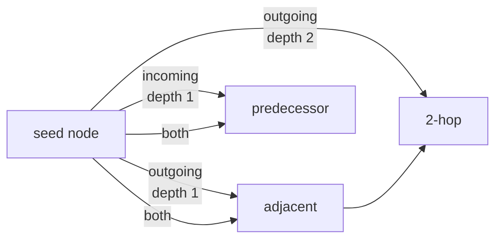

# Lain Query Language — Machine Reference

Query the LAIN knowledge graph via `query_graph` MCP tool.

> **Federation note:** cross-repo queries (`get_cross_repo_blast_radius`, `search_org`) require federation mode (`lain server --config repos.yaml`). See [`docs/FEDERATION.md`](./FEDERATION.md) for the full guide.

```mermaid
flowchart LR
    OPS["ops[]"] --> F["find"] --> C1["connect"] --> FL["filter"] --> SF["semantic_filter"] --> G["group"] --> S["sort"] --> L["limit"]
    C1 -.0..n more connects.-> C2["connect"]
    C1 -.alternative.-> T["target<br/>(nested FindOp)"]
```

The `query_graph` pipeline runs each op in declaration order,
streaming a working-set of nodes from one stage into the next. Any
op may be omitted (e.g. `find → limit` is valid). `semantic_filter`
is the only op that hits the ONNX embedder; everything else reads
the in-memory petgraph.

---

## Tool Call

```json
{
  "name": "query_graph",
  "arguments": {
    "query": {
      "ops": [...],
      "mode": "auto",
      "named": null
    }
  }
}
```

The tool's input schema declares one property, `query` (see
`docs/tool-schema.json`). The handler also accepts the same object
under `spec`, or the `QuerySpec` fields unwrapped as top-level
arguments.

---

## QuerySpec

```json
{
  "ops": [...],           // Array of GraphOp (required)
  "mode": "auto",         // "query" | "tool" | "auto" (default: auto)
  "named": null           // Prebuilt query name (see Named Queries)
}
```

---

## Operations

### find

Locate nodes in the graph.

```json
{ "op": "find", "type": "Function", "name": "foo", "label": "deprecated" }
```

| Field | Type | Description |
|-------|------|-------------|
| `type` | string \| `["Type1", "Type2"]` | Node type — see [Node Types](#node-types). Omit to match every kind |
| `name` | string | Exact name (or object with exact/glob/startsWith/endsWith) |
| `id` | string | Node UUID — exact match. Honoured in a top-level `find` and inside a `connect` `target`; an id no node has selects nothing |
| `label` | string \| `["L1"]` \| `{"not": ["L1"]}` | Node label: exact, any-of, or none-of. The label is `deprecated` when the symbol is deprecated (`#[deprecated]`, LSP deprecated tag), else the attribute-derived label the indexer attached — `test` from `#[test]` or a test container, otherwise the attribute's identifier (`async_trait`, `no_mangle`, …). Unlabelled nodes match none of the positive forms and all `{"not": [...]}` forms |
| `path` | string | Substring match on the node's path |

Name selector object:
```json
{ "name": { "exact": "foo" } }
{ "name": { "glob": "foo*" } }
{ "name": { "startsWith": "test_" } }
{ "name": { "endsWith": "_test" } }
```
The `starts_with` / `ends_with` spellings are accepted as well.

### connect

Traverse edges from found nodes.



```json
{ "op": "connect", "edge": "Calls", "direction": "outgoing", "depth": 3 }
```

```json
{ "op": "connect", "edge": "Calls", "direction": "incoming", "depth": { "min": 1, "max": 2 }, "target": { "type": "Function" } }
```

| Field | Description |
|-------|-------------|
| `edge` | An [Edge Types](#edge-types) name, an array of names (any-of), or `{"not": [...]}` (none-of) |
| `direction` | `outgoing` \| `incoming` \| `both` (default `outgoing`). `both` walks each direction as its own pure traversal (outgoing-only paths ∪ incoming-only paths) — a single path never mixes directions |
| `depth` | Integer `N` — report nodes at hops 1..=N, where hops are counted along a shortest matching-edge path. Start nodes are never reported (not even back through a cycle), so `0` selects nothing. Or `{ "min": N, "max": M }` — hops N..=M inclusive; nearer nodes are walked through but not reported |
| `target` | Optional nested `FindOp` — keep only the reached nodes it selects (`id` matches exactly here too) |

### filter

Narrow current result set. Same selectors as `find`: `type`, `name`,
`label`.

```json
{ "op": "filter", "type": "Function", "name": { "glob": "test_*" }, "label": "deprecated" }
```

### semantic_filter

Keep nodes semantically similar to a natural-language query.

```json
{ "op": "semantic_filter", "like": "authentication flow", "threshold": 0.3 }
```

| Field | Type | Description |
|-------|------|-------------|
| `like` | string | Natural-language query (required) |
| `threshold` | number 0.0–1.0 | Minimum cosine similarity (default `0.3`) |

Nodes without a usable embedding are dropped.

### group

Group results.

```json
{ "op": "group", "by": "type" }
```

`by`: `type` \| `label` \| `name`

### sort

Order results.

```json
{ "op": "sort", "by": "name", "direction": "asc" }
```

`by`: `name` \| `type` \| `label`
`direction`: `asc` \| `desc` (default `asc`)

### limit

Paginate.

```json
{ "op": "limit", "count": 10, "offset": 0 }
```

Without a `limit` op, the executor caps the answer at
`tuning.ingestion.default_query_limit` (default 100) and reports the
trim in `meta.truncated` / `meta.matched_before_limit`.

---

## Named Queries

Pass `named` instead of `ops` for prebuilt queries:

```json
{ "named": "get_blast_radius" }
{ "named": "get_call_chain" }
{ "named": "get_callers" }
{ "named": "get_callees" }
{ "named": "get_file_functions" }
{ "named": "get_module_functions" }
{ "named": "get_deprecated_functions" }
```

Named queries take no parameters: they run over the whole graph. To aim
one at a symbol, write the `ops` yourself (examples below), or use the
dedicated tools (`get_call_chain`, `get_call_sites`, `get_blast_radius`).

---

## Result Format

The executor returns `QueryResult`; the tool handler then splices in
`occupancy`. Empty arrays and absent options are omitted from the
JSON, not emitted as `null`.

```json
{
  "nodes": [{ "id": "...", "type": "Function", "name": "foo" }],
  "count": 42,
  "legacy": false,
  "meta": {
    "exec_us": 1234,
    "nodes_visited": 156
  },
  "groups": [{ "key": "Function", "count": 40, "nodes": ["..."] }],
  "occupancy": {
    "active_agents": [{ "agent_id": "...", "name": "...", "files": ["src/lib.rs"] }]
  }
}
```

| Field | Description |
|-------|-------------|
| `nodes` | Matched nodes (`id`, `type`, `name`, and `label` — `deprecated`, `test`, or another attribute-derived label; the field is omitted when the node carries none). Omitted when empty |
| `count` | Number of nodes returned, after `limit` or the default cap |
| `legacy` | `true` when the result came from a `named` query |
| `meta.exec_us`, `meta.nodes_visited` | Always present |
| `meta.truncated`, `meta.matched_before_limit` | Only when the default cap trimmed the result |
| `groups` | Only after a `group` op: `{ key, count, nodes }` entries. Omitted otherwise |
| `occupancy` | Active agents in this workspace and the files each has claimed (`active_agents: []` when none registered). Added by the tool handler, not the executor |
| `edges` | The deduplicated union of the `paths` edges — the edges walked to reach the reported nodes (`{ id, type, from, to }`, sorted by `from`, `to`, `type`). Only when the reported nodes came from a `connect`; see [Edges and paths](#edges-and-paths). Omitted when empty |
| `paths` | One selected shortest path per reported node, parallel to `nodes` (seed first). Only when the reported nodes came from a `connect`; see [Edges and paths](#edges-and-paths). Omitted when empty |

`meta.plan` has been removed from `QueryMeta` — it never appeared on the
wire (always `None`), so only the Rust type changes.

### Edges and paths

When the reported nodes were produced by a `connect` step, the result
carries the edges that were walked to reach them and one selected shortest
path per node. Find/filter-only pipelines carry neither field (empty
arrays are omitted from the JSON).

```json
{
  "nodes": [{ "id": "…b", "type": "Function", "name": "b" }],
  "edges": [
    { "id": "…a->…b:Calls", "type": "Calls", "from": "…a", "to": "…b" }
  ],
  "paths": [
    {
      "nodes": [
        { "id": "…s", "type": "Function", "name": "s" },
        { "id": "…a", "type": "Function", "name": "a" },
        { "id": "…b", "type": "Function", "name": "b" }
      ],
      "edges": [
        { "id": "…s->…a:Calls", "type": "Calls", "from": "…s", "to": "…a" },
        { "id": "…a->…b:Calls", "type": "Calls", "from": "…a", "to": "…b" }
      ]
    }
  ],
  "count": 1
}
```

- `paths` is parallel to `nodes`: `paths[i]` is the path to `nodes[i]`.
  Each path is `nodes` (walk order, seed first, reported node last) plus
  `edges` (one per hop). `edges[k]` joins `nodes[k]` to `nodes[k+1]` and
  carries the edge's stored direction — on an `incoming` walk the edge
  points from the later node to the earlier one. The hop count obeys the
  same `depth` range as node reporting: start nodes are never reported
  (not even back through a cycle), and `min > 1` walks through nearer
  nodes, which appear only as intermediate path nodes.
- A node gets **one** path, even under `direction: both` (a path never
  mixes directions — it comes from one pure walk). The selected path is
  the shortest matching-edge path from the seed of the walk that reached
  the node; ties resolve deterministically, in this order:
  1. fewest hops;
  2. the outgoing walk's path over the incoming walk's (`direction: both`);
  3. the lowest seed id, when several seeds reach the node at the same length;
  4. at each hop, the lowest-id predecessor at the next-lower hop count;
  5. among parallel matching edges on that pair, the smallest edge type name.
- `edges` is the deduplicated union of the edges on those paths (one entry
  per `from`/`to`/`type`), sorted by `from`, `to`, `type`. An edge's `id`
  is its `{from}->{to}:{type}` key. Transit edges of intermediate nodes are
  included even when those nodes are not reported themselves; edges of
  unselected alternative routes are not.
- Paths come from the `connect` step that produced the node; chained
  `connect` steps do not compose paths across steps.
- `meta.truncated` (or a `limit` op) trims `nodes`, and `edges`/`paths`
  follow exactly the nodes that were reported.

---

## Examples

### Find all functions named "handle" and their callers

```json
{
  "ops": [
    { "op": "find", "type": "Function", "name": "handle" },
    { "op": "connect", "edge": "Calls", "direction": "incoming", "depth": 1 },
    { "op": "limit", "count": 20 }
  ]
}
```

### Get blast radius of a symbol

```json
{ "named": "get_blast_radius" }
```

With args via `ops` equivalent:
```json
{
  "ops": [
    { "op": "find", "type": "Function", "name": "my_func" },
    { "op": "connect", "edge": "Calls", "direction": "outgoing", "depth": { "min": 1, "max": 2 } },
    { "op": "connect", "edge": "Calls", "direction": "incoming", "depth": { "min": 1, "max": 2 } }
  ]
}
```

### Find files that co-change with a given file

```json
{
  "ops": [
    { "op": "find", "type": "File", "name": "auth.rs" },
    { "op": "connect", "edge": "CoChangedWith", "direction": "both", "depth": 1 }
  ]
}
```

### Get all untested functions in a module

Use the `find_untested_functions` tool: "has no caller" is an absence,
which a `connect` step cannot express.

### Find deprecated functions

```json
{
  "ops": [
    { "op": "find", "type": "Function", "label": "deprecated" },
    { "op": "filter", "name": { "startsWith": "deprecated_" } },
    { "op": "sort", "by": "name" },
    { "op": "limit", "count": 50 }
  ]
}
```

### Get call chain between two functions

```json
{
  "ops": [
    { "op": "find", "type": "Function", "name": "caller" },
    { "op": "connect", "edge": "Calls", "direction": "outgoing", "depth": 10, "target": { "name": "callee" } }
  ]
}
```

### Structural coverage summary for a module

Use the `get_coverage_summary` tool.

### Explain a symbol

```json
{
  "ops": [
    { "op": "find", "type": "Function", "name": "process_request" },
    { "op": "connect", "edge": "Calls", "direction": "both", "depth": 1 },
    { "op": "group", "by": "type" }
  ]
}
```

---

## Edge Types

Every variant of the `EdgeType` enum (`src/server/schema.rs`), which
is also what `describe_schema` reports from the same enum. Edges
marked *not emitted* have no producing indexer (`indexed: false`) —
traversing one always returns nothing.

| Edge | Meaning |
|------|---------|
| `Contains` | File/module contains a symbol |
| `Calls` | Function invocation |
| `Uses` | Code uses a variable or type |
| `Implements` | Class implements an interface |
| `Imports` | Import/use statement — **not emitted** (`indexed: false`: no indexer produces it) |
| `CoChangedWith` | Historical co-change (temporal coupling, not a static dependency) |
| `Pattern` | Semantic boundary indicator (path prefix, topic name) |
| `CallsHttp` | HTTP route → handler |
| `Produces` / `Consumes` | Producer/consumer ↔ message topic |
| `DeployedTo` | IaC resource → cloud resource — **not emitted** (`indexed: false`) |
| `CrossRepoSameSymbol` | Federation-only: same symbol in two repos |
| `DynamicDispatch` | Heuristic: call whose receiver type is not statically known (carries a heuristic provenance) |
| `BusTopic` | Heuristic: producer/consumer of a named topic or event bus |
| `RouteMatches` | Heuristic: path/pattern routed to a handler via a schema-driven router |
| `RuntimeCall` | Caller/callee pair observed in an OpenTelemetry span |
| `SendsHttp` | Function/method → its `HttpClientCall` call site |
| `RequestSchema` / `ResponseSchema` | `HttpRoute` → `Schema` (request body / 2xx responses) |
| `PayloadSchema` | `Topic` → `Schema` (payload schema) |
| `HasField` | `Schema` → its flattened `Field` |
| `ReadsField` | Function/method → `FieldRef` (a response-field read) |
| `ReadsFrom` | `FieldRef` → the `HttpClientCall` whose response it reads |
| `Binds` | Federation-only: consumer → matched provider |
| `ReadsTable` / `WritesTable` | Function/method/file → `Table` (SELECT / INSERT·UPDATE·DELETE) |

## Node Types

Every variant of the `NodeType` enum (`src/server/schema.rs`), which
is also what `describe_schema` reports. `Resource` is the only type
with `indexed: false` — no indexer emits it yet.

`File`, `Namespace`, `Module`, `Package`, `Class`, `Interface`, `Struct`,
`Enum`, `Trait`, `Function`, `Method`, `Property`, `Variable`, `Constant`,
`HttpRoute`, `Topic`, `Resource`, `Schema`, `HttpClientCall`, `Field`,
`FieldRef`, `Synthetic`, `Table`

`Function` and `Method` are distinct. In Rust and other impl-heavy
languages most code is a `Method`, so a query filtered to `Function`
alone silently misses it — call `describe_schema` if in doubt, and note
that `find` without a `type` matches every kind.
